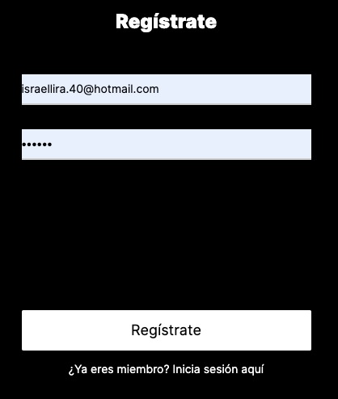
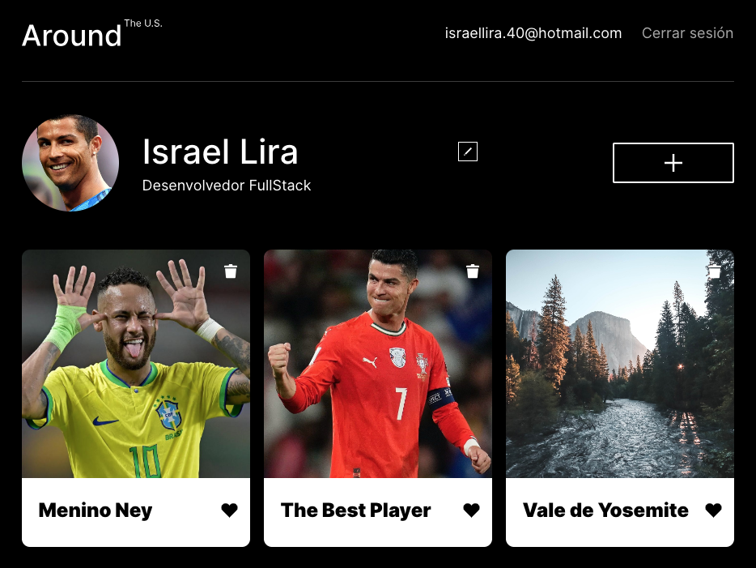

# Around the U.S. (web_project_api_full)

Aplicação full-stack do projeto **Around the U.S.**, desenvolvida no bootcamp da TripleTen. Reúne o front-end em React e a API em Node.js/Express, com cadastro, login por JWT e rotas protegidas. Os usuários podem criar uma conta, editar o perfil e o avatar, e adicionar, curtir e remover cartões de lugares.

## Funcionalidades

- Cadastro de usuário e login, com popup de sucesso ou erro.
- Rota principal protegida: quem não está autenticado vai para `/signin`.
- Token JWT (validade de 7 dias) salvo no `localStorage`, com a sessão mantida ao recarregar a página.
- Cartões: listar, adicionar, curtir, descurtir e remover (só o dono remove o próprio cartão).
- Edição de perfil e de avatar, sempre da própria conta.
- Tratamento centralizado de erros, validação das requisições e registro de logs na API.

## Tecnologias e técnicas

**Front-end** (`frontend/`)

- React com componentes funcionais e hooks, React Router e Context API.
- Vite como ferramenta de build.
- HTML5 e CSS3 com a metodologia BEM.

**Back-end** (`backend/`)

- Node.js e Express, com MongoDB e Mongoose.
- Autenticação com JWT (`jsonwebtoken`) e senhas com hash (`bcryptjs`).
- Validação de dados com `celebrate`/Joi e `validator`.
- Tratamento centralizado de erros em um único middleware.
- Logs em JSON (`request.log` e `error.log`) com `winston` e `express-winston`.
- CORS habilitado, ESLint (airbnb-base) e PM2 para manter o servidor no ar.

## Estrutura do repositório

```
backend/    API em Node.js (controllers, models, routes, middlewares, errors, utils)
frontend/   aplicação em React
README.md
DEPLOY.md   passo a passo da implantação no servidor
```

## Como executar localmente

Pré-requisitos: Node.js 18 ou superior e um MongoDB em execução em `mongodb://localhost:27017`.

```bash
# Back-end (porta 3001)
cd backend
npm install
npm run dev

# Front-end (porta 3000), em outro terminal
cd frontend
cp .env.example .env     # VITE_API_URL=http://localhost:3001
npm install
npm run dev
```

Em desenvolvimento a API roda sem arquivo `.env` (usa um segredo de desenvolvimento). Em produção, defina `NODE_ENV=production` e `JWT_SECRET` no `.env` do servidor (veja `backend/.env.example`).

## Rotas da API

| Método | Rota | Descrição | Autenticação |
| --- | --- | --- | --- |
| POST | `/signup` | Cria um usuário | não |
| POST | `/signin` | Devolve o token JWT | não |
| GET | `/users/me` | Usuário atual | sim |
| PATCH | `/users/me` | Atualiza nome e sobre | sim |
| PATCH | `/users/me/avatar` | Atualiza o avatar | sim |
| GET | `/users`, `/users/:userId` | Lista ou busca usuários | sim |
| GET | `/cards` | Lista os cartões | sim |
| POST | `/cards` | Cria um cartão | sim |
| DELETE | `/cards/:cardId` | Remove o próprio cartão | sim |
| PUT / DELETE | `/cards/:cardId/likes` | Curte / descurte | sim |

Códigos de erro: `400` dados inválidos, `401` token inválido ou login incorreto, `403` sem autorização ou cartão de outra pessoa, `404` não encontrado, `409` e-mail já cadastrado, `500` erro no servidor. A resposta de erro tem apenas o campo `message`.

## Capturas de tela

### Tela de login


### Registro



### Início



## Links

- Aplicativo (front-end): https://israelaround.mooo.com
- API (back-end): https://api.israelaround.mooo.com
- Demonstração em vídeo: _adicione aqui o link_
